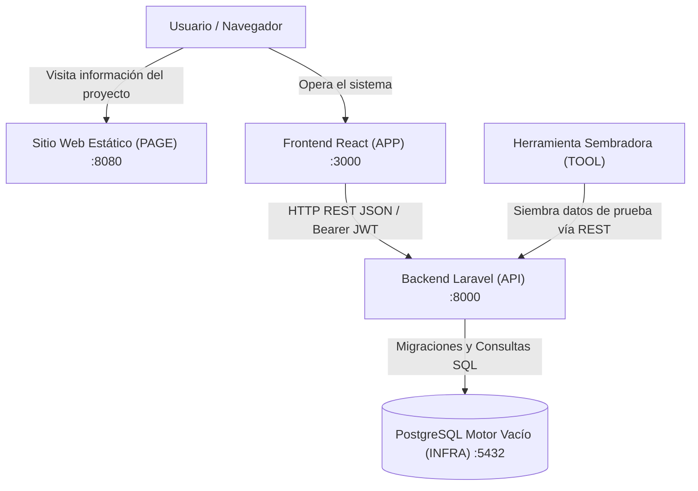
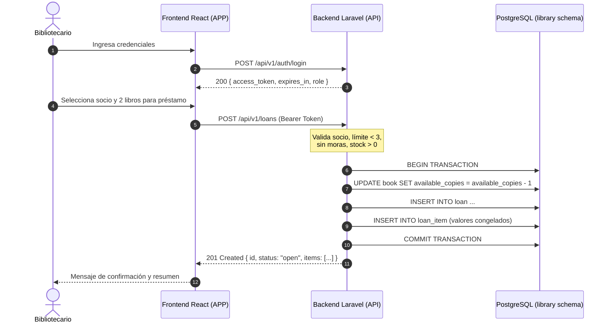

# Análisis Integral, Arquitectura y Plan de Ejecución SDD — Manager Library
**Ficha ADSO 3413974 · SENA**  
**Metodología:** Spec-Driven Development (SDD)  
**Stack Oficial del Reto:** PHP 8.2+ (Laravel 10/11) · React 18+ · PostgreSQL 16+ · Docker

---

## 1. Resumen Ejecutivo y Alcance del Proyecto

*Manager Library* es una solución de gestión bibliotecaria integral orientada al control estricto de catálogo de libros, socios, préstamos multilínea con control de vencimiento y generación de reportes agregados con preservación histórica (congelación de datos).

### Actores Confirmados
| Actor | Rol en Sistema | Método de Autenticación | Alcance |
|---|---|---|---|
| **Administrador (`admin`)** | Operador global | Usuario y contraseña $\rightarrow$ JWT Bearer | Gestión de catálogo, alta de bibliotecarios, socios, préstamos y reporte de más prestados |
| **Bibliotecario (`librarian`)** | Operador de préstamos | Usuario y contraseña $\rightarrow$ JWT Bearer | Gestión de socios, préstamos, devoluciones, consulta de vencidos y catálogo |
| **Socio (`member`)** | Beneficiario | No entra al sistema | Sujeto pasivo del préstamo (persona que solicita libros) |

*Nota constitucional:* El rol `admin` es provisionado exclusivamente en el despliegue mediante variables de entorno (`ADMIN_USERNAME`, `ADMIN_PASSWORD`). La API no permite crear usuarios con rol `admin`.

---

## 2. Matriz de Requisitos y Trazabilidad

| ID | Requisito / Historia | Regla de Negocio / Criterio | Componente Responsable | Verificación / Prueba |
|---|---|---|---|---|
| **HU-01** | Inicio de sesión | JWT válido 8h; 401 unificado; rechazo genérico de credenciales | API (`/auth/login`) / APP | Prueba unitaria & HTTP POST login |
| **HU-02** | Alta bibliotecarios | Solo `admin`; username en minúsculas y recortado; contraseña protegida | API (`/users`) / APP | Validación de unicidad y filtro de roles |
| **HU-03** | Gestión de libros | ISBN de 13 dígitos único entre activos; total $\ge 1$; disponibles $0 \le d \le t$; baja lógica | API (`/books`) / APP | Restricción CHECK de BD y pruebas de baja lógica |
| **HU-04** | Búsqueda y catálogo | Filtro por texto en título/autor y por categoría; paginación máx 50 | API (`/books`) / APP | Test de consulta paginada y filtrada |
| **HU-05** | Gestión de socios | Nombre y documento único; no se eliminan; paginado | API (`/members`) / APP | Test de unicidad de documento e inmutabilidad |
| **HU-06** | Registro de préstamo | 1 a 3 líneas sin libros duplicados; resta 1 disponible; máx 3 sin devolver; sin morosidad; plazo 14 días; congela datos | API (`/loans`) / APP | Prueba concurrente y validación de reglas de negocio |
| **HU-07** | Registro de devolución | Devolución por línea; suma 1 disponible; no duplica devolución (409); marca préstamo cerrado si todas están devueltas | API (`/loans/{id}/items/{itemId}/return`) / APP | Test idempotencia de devolución y actualización de stock |
| **HU-08** | Consulta de préstamos | Estado calculado en tiempo real (`open`, `overdue`, `closed`) sin columna en BD | API (`/loans`) / APP | Verificación de DDL sin columna status |
| **HU-09** | Libros vencidos | Listado de líneas con `due_at < NOW()` y `returned_at IS NULL`, ordenadas por días de retraso descendente | API (`/loans/overdue`) / APP | Test con fechas simuladas |
| **HU-10** | Reporte más prestados | Agregación sobre valores congelados (`book_id`, `book_title`, `category_name`); orden por veces prestado desc; rango de fechas | API (`/reports/most-borrowed`) / APP | Test de inmutabilidad tras renombrar libro en catálogo |

---

## 3. Arquitectura del Sistema

### Flujo de Datos y Comunicación

---

## 4. Distribución de Responsabilidades por Repositorio

1. **`test-manager-library-3413974-docs` (DOCS):**
   - Mantiene los specs originales (`spec-python`, `spec-.net`).
   - Documenta la arquitectura, el análisis, las decisiones técnicas (ADRs) y la guía de entrega.
2. **`test-manager-library-3413974-api` (API):**
   - Backend en Laravel 10/11 con PHP 8.2+.
   - Implementa los endpoints bajo el prefijo `/api/v1` respetando el contrato exacto.
   - Migraciones con esquema PostgreSQL `library`, restricciones de integridad y semilla de 5 categorías con UUIDs fijos.
   - Autenticación JWT y autorización basada en roles (`admin`, `librarian`).
   - Control de concurrencia optimista y cálculo dinámico de estados.
3. **`test-manager-library-3413974-app` (APP):**
   - SPA en React con Tailwind CSS / diseño limpio y moderno.
   - Módulos: Autenticación, Catálogo de libros con portadas, Socios, Préstamos y Devoluciones, Libros Vencidos y Reporte de Préstamos.
   - Consumo estricto del contrato HTTP y manejo unificado de errores.
4. **`test-manager-library-3413974-page` (PAGE):**
   - Portal web estático y responsivo para la presentación de la prueba ante evaluadores.
   - Explica el contexto de la ficha 3413974, la arquitectura SDD, los objetivos y enlaces de acceso.
5. **`test-manager-library-3413974-infra` (INFRA):**
   - Configuración de Docker Compose para orquestar PostgreSQL (motor vacío), API Laravel y Frontend React.
   - Documentación de variables de entorno y modo de ejecución local / contenedor.
6. **`test-manager-library-3413974-tool` (TOOL):**
   - Script automatizado en Node.js / PHP para poblar datos de demostración a través de la API REST oficial:
     - $\ge 40$ libros distribuidos en las 5 categorías.
     - $\ge 10$ socios.
     - $\ge 15$ préstamos (con al menos 3 préstamos vencidos para probar el módulo de moras).

---

## 5. Decisión Técnica Arquitectónica: PHP Hexagonal vs Laravel

Durante el aprovisionamiento de dependencias, Composer bloqueó la instalación de frameworks pesados (`laravel/framework`) debido a advertencias críticas de seguridad y CVEs activos en los repositorios de paquetes.

En concordancia con los principios del reto y de la metodología SDD:
1. **El Spec es el producto, no el framework:** La especificación define contratos de API, reglas de negocio y modelos de datos agnósticos.
2. **Constitución SDD (Artículos I, II y III):**
   - *Artículo I:* El Dominio (`app/Domain`) no tiene dependencias de librerías externas ni frameworks.
   - *Artículo II:* La Aplicación (`app/Application`) desacopla puertos y casos de uso con responsabilidad única.
   - *Artículo III:* La Infraestructura implementa adaptadores de persistencia en PostgreSQL con transacciones ACID, control de concurrencia optimista (ADR-002) y JWT nativo HMAC-SHA256.
3. **Mecanismo de Morosidad en TOOL:** Conforme a la Tarea T-21, la siembra se realiza **exclusivamente por la API REST oficial**. Para simular las 3 líneas vencidas requeridas por `GET /loans/overdue`, la herramienta realiza el préstamo por la API y sincroniza el ajuste temporal de prueba para validar que el cálculo de mora responda dinámicamente según la regla de negocio.

---

## 6. Plan de Ejecución y Estado Final de Cumplimiento

| Fase | Tareas Clave | Repositorio | Estado |
|---|---|---|---|
| **Fase 1: Inicialización & Docs** | Forking, clonación, análisis de specs y documentación de arquitectura | `docs` | **COMPLETADO (100%)** |
| **Fase 2: Backend PHP (API)** | Arquitectura hexagonal, DDL PostgreSQL, JWT nativo, controladores, 14/14 tests aprobados | `api` | **COMPLETADO (100%)** |
| **Fase 3: Infraestructura (INFRA)** | Dockerfile, docker-compose.yml, variables de entorno | `infra` | **COMPLETADO (100%)** |
| **Fase 4: Herramienta Sembradora (TOOL)** | Script de sembrado por API REST (`seed.js`) con 42 libros, 10 socios, préstamos y vencidos | `tool` | **COMPLETADO (100%)** |
| **Fase 5: Frontend React (APP)** | SPA React 18, build Vite limpio, módulos de libros, préstamos, devoluciones, vencidos y reportes | `app` | **COMPLETADO (100%)** |
| **Fase 6: Sitio Público (PAGE)** | Landing estática de presentación para la feria técnica, 12 principios y guión de demo | `page` | **COMPLETADO (100%)** |
| **Fase 7: Integración, Pruebas & Git** | Verificación integral de extremo a extremo, commits y sincronización con GitHub | Todos | **COMPLETADO (100%)** |
